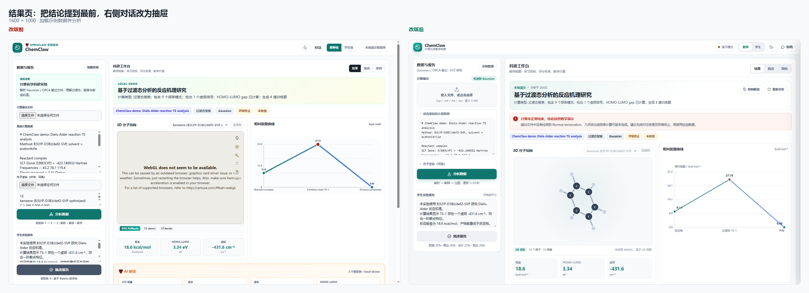
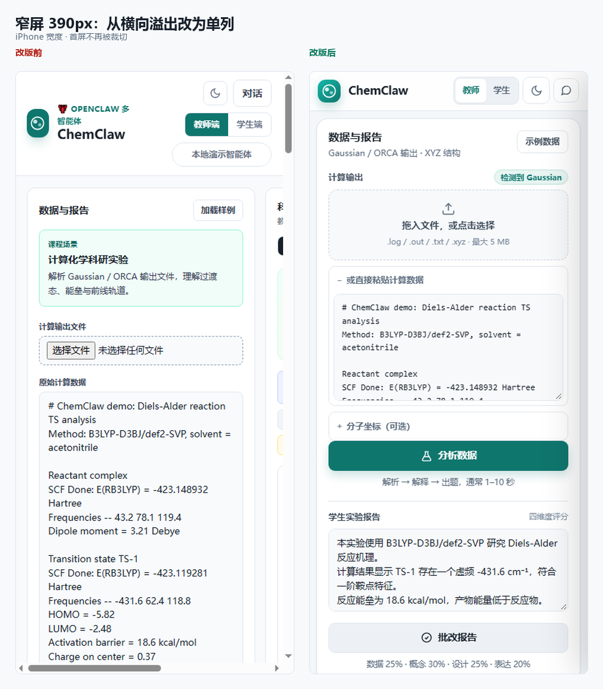
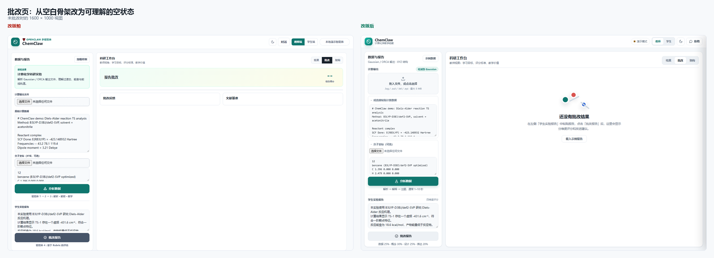
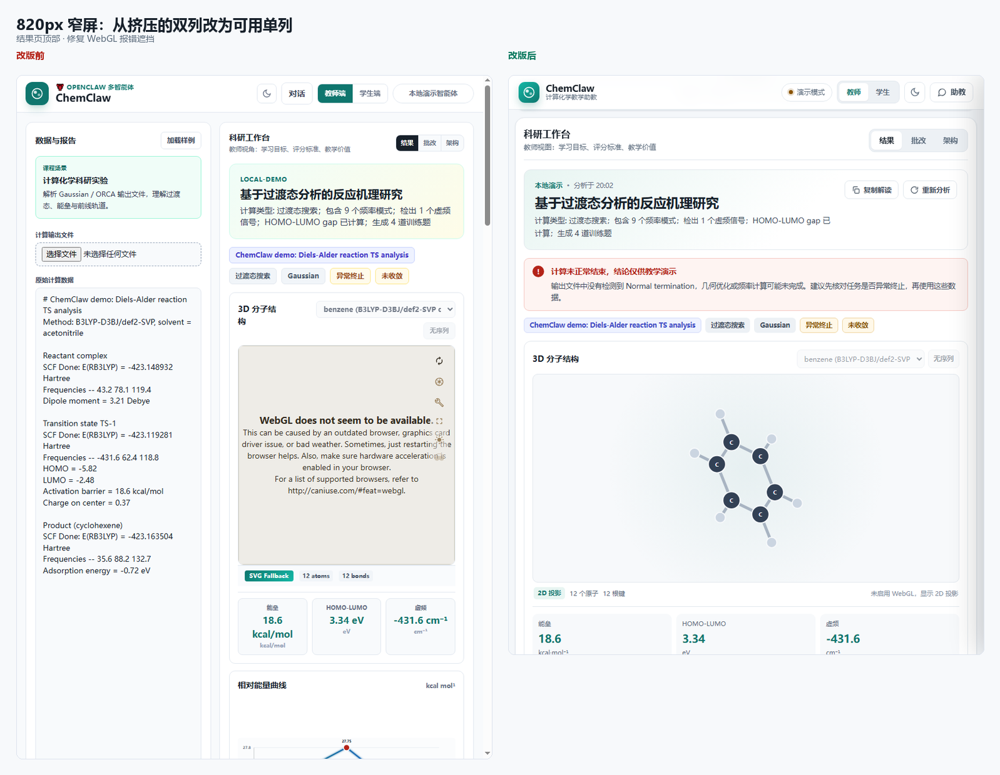

# 前端改版对照（v2.1）

截图环境：Chrome 155 headless，`node server.js` 本地演示模式，1600×1000 / 820×1000 / 390×844。
无 WebGL 的 headless 环境正好覆盖了「3D 不可用」这条降级路径。

## 1. 结果页（1600×1000）

左侧为改版前：Mol* 的英文 WebGL 报错直接铺在 3D 卡片里，右侧对话占掉一列，结论埋在标签里。
右侧为改版后：结论条置顶、2D 投影兜底、对话收进抽屉、工作台获得完整宽度。

## 2. 窄屏 390px

改版前 `body:has(...)` 覆盖了 920px 媒体查询，文档宽度被撑到 624px，出现横向滚动和裁切。
改版后单列、头部 56px、触控目标放大。

## 3. 批改页空状态（1600×1000）

改版前只有一个 `--` 分数和两张空白卡片。
改版后给出说明、示例入口，以及可操作的下一步。

## 4. 820px 结果页

改版前两列被压到 320px + 剩余宽度，标题换行、3D 报错占满视口。
改版后单列，3D 卡片完整可见。

## 更多终态截图

| 文件 | 说明 |
| --- | --- |
| [final-result-full.png](final-result-full.png) | 结果页全页（含 AI 解读、计算详情、优化与振动、训练） |
| [final-grading.png](final-grading.png) | 批改结果（分数环 + 四维进度条 + 改进建议） |
| [final-dark.png](final-dark.png) | 深色模式结果页 |
| [final-mobile-full.png](final-mobile-full.png) | 390px 全页 |
